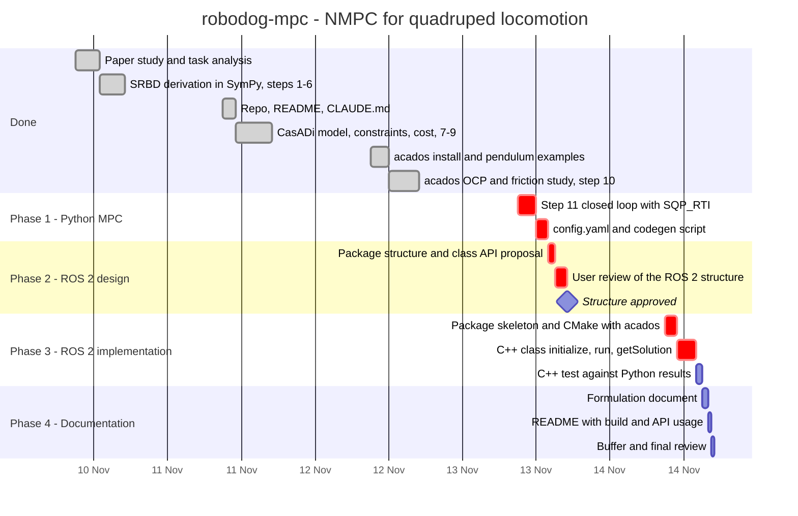

# Project plan

Remaining time: **2 working days** (Fri 13 – Sat 14 Nov 2026), estimated from the pace so far.
Environment check: ROS 2 Humble and colcon are installed; acados v0.6.0 is built.

The ROS 2 work is split into a **design phase**, a **review by the user**, and an **implementation phase**,
so the package structure is agreed on before any C++ is written.

## Phases and tasks

### ✅ Done (10–12 Nov)
| Task | Deliverable |
|---|---|
| Paper study, task analysis | — |
| SRBD derivation in SymPy, paper errata | `derivation/step1–6` |
| Repo, README, CLAUDE.md | — |
| CasADi model, constraints, cost | `derivation/step7–9` |
| acados install, pendulum examples | `examples/pendulum` |
| acados OCP, friction study (16-gon default) | `derivation/step10` |

### Phase 1: Python MPC complete (Fri 13 Nov, morning)
| Task | Est. | Deliverable |
|---|---|---|
| Closed loop: acados simulator as plant, `SQP_RTI`, warm start, moving contact schedule and footholds | 3 h | `derivation/step11` |
| `config.yaml` (mass, inertia, μ, weights, N, dt, solver options) and a codegen script that builds the solver from it | 2 h | `config.yaml`, `generate_solver.py` |

### Phase 2: ROS 2 design (Fri 13 Nov, afternoon)
| Task | Est. | Deliverable |
|---|---|---|
| Proposal: package layout, CMake strategy for acados and the generated code, class API (inputs/outputs of `initialize`/`run`/`getSolution`), how `config.yaml` is loaded | 1 h | `docs/ros2_design.md` |
| **User review** of the proposal; changes agreed | 2 h | approved design |
| ◆ **Milestone: structure approved.** Phase 3 starts only after this. | | |

### Phase 3: ROS 2 implementation (Sat 14 Nov, morning)
| Task | Est. | Deliverable |
|---|---|---|
| Package skeleton; CMake links acados and the generated solver; builds with colcon | 2 h | `robodog_mpc/` |
| C++ class `initialize()`, `run()`, `getSolution()`; parameters from `config.yaml` | 3 h | `src/`, `include/` |
| C++ test: same problem as the Python solver, compare forces | 1 h | `test/` |

### Phase 4: Documentation and delivery (Sat 14 Nov, afternoon)
| Task | Est. | Deliverable |
|---|---|---|
| Formulation document: SRBD model, MPC problem, friction models | 1 h | `docs/formulation.md` |
| README: dependencies, build, API usage | 30 min | `README.md` |
| Buffer, final review | 30 min | — |

**Critical path:** closed loop → config + codegen → ROS 2 design → review → skeleton/CMake → C++ class.

## Risks

- **Review takes longer than planned:** Phase 3 moves back and Phase 4 shrinks. Mitigation: the
  formulation document can be written in parallel while the review is ongoing.
- **CMake + acados linking** (Phase 3): fiddly the first time (library paths, generated code location).
  Mitigation: settle the strategy in the design phase; the pendulum's `main_ocp_*.c` already shows the
  exact C calls.
- **Closed-loop stability** (Phase 1): RTI with a moving contact schedule may need tuning (weights,
  horizon). Mitigation: trot in place first, then forward.
- **What needs regeneration:** N and the friction model are fixed at code generation; everything else
  (mass, inertia, μ, weights, contact, footholds, commands) is runtime. Document this in `config.yaml`.
- **Out of scope if time runs short:** exact-cone convergence (parked), yaw/position tracking, a gait
  planner inside the class.
