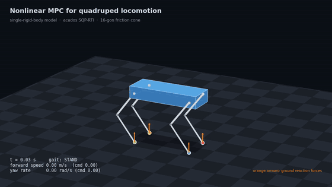

# robodog-mpc

Nonlinear MPC for quadruped locomotion based on the Single Rigid Body Dynamics (SRBD) model.

**Reference:** J. Di Carlo, P. M. Wensing, B. Katz, G. Bledt, S. Kim,
*Dynamic Locomotion in the MIT Cheetah 3 Through Convex Model-Predictive Control*, IROS 2018.
[IEEE Xplore](https://ieeexplore.ieee.org/document/8594448)

The paper freezes yaw and the foot lever arms to get a linear (convex) MPC. We keep the same
model but leave those as functions of the state, which makes it nonlinear and suitable for NMPC.

The repository contains the step-by-step derivation (Python: SymPy, CasADi, acados) and a **ROS 2 C++ package**
with a standalone solver class: give it the measured state, the commanded velocity and yaw rate and the
contact state of the feet; it returns the 3D ground reaction force of each foot
([C++ / ROS 2 package](#c--ros-2-package-robodog_nmpc)). The mathematical formulation is in
[docs/formulation.md](docs/formulation.md), the package design in [docs/ros2_design.md](docs/ros2_design.md).



*Closed-loop simulation (step 11): stand → trot in place → trot forward at 0.5 m/s → turn at 0.6 rad/s.
Orange arrows are the ground reaction forces computed by the NMPC. The legs are for display only;
the controller uses the single-rigid-body model.*

## Derivation (`robodog_nmpc/scripts/derivation/`)

Step-by-step SymPy scripts following Section III of the paper:

| Step | Script | Paper | Content |
|---|---|---|---|
| 1 | `step1_rotations.py` | Eq. 8 | `R = Rz(ψ) Ry(θ) Rx(φ)` |
| 2 | `step2_angular_velocity.py` | Eq. 9 | `ω = E(Θ) Θ̇` from `Ṙ Rᵀ = [ω]×` |
| 3 | `step3_euler_rates.py` | Eqs. 10–12 | `E⁻¹`, small-angle `Θ̇ ≈ Rz(ψ)ᵀ ω` |
| 4 | `step4_inertia.py`, `step4b_check_inertia.py` | Eqs. 14–15 | World-frame inertia `Î = Rz ᴮI Rzᵀ` |
| 5 | `step5_equations_of_motion.py` | Eqs. 5–7, 13 | Full 12-state model `ẋ = f(x, u)` |
| 6 | `step6_matrix_form.py` | Eqs. 16–17 | Same model in matrix form, standing check |
| 7 | `step7_casadi_model.py` | — | Model in CasADi (`f_dyn(x, u, P)`), verified against SymPy |
| 8 | `step8_constraints.py` | Eqs. 20–24 | Contact bounds, friction models: 16-gon (default), exact cone, pyramid |
| 9 | `step9_cost.py` | Eq. 18 | Least-squares cost: heading-frame velocity, yaw rate, height, roll/pitch, forces |
| 10 | `step10_acados_ocp.py` | Sec. IV | Full NMPC as an acados OCP; standing, trot and hard-acceleration tests |
| 11 | `step11_closed_loop.py` | Sec. V | Closed loop with SQP-RTI: stand, trot, forward, turn; plots, solve-time histogram (cf. Fig. 4) |

**Friction model.** The friction cone `√(f_x² + f_y²) ≤ μ f_z` is enforced through one of three options
(`build_solver(friction=...)` in step 10):

| Option | Constraint | Notes |
|---|---|---|
| `polygon` (**default**) | inscribed 16-gon of the cone, `cos θⱼ f_x + sin θⱼ f_y − μ cos(π/16) f_z ≤ 0` | linear in `u` → fast, robust SQP; never exceeds μ; at most 1.9 % conservative; μ is a runtime parameter |
| `cone` | exact cone, `√(f_x² + f_y² + ε²) − μ f_z ≤ 0` | available; converges slowly (26 vs. 6 SQP iterations on a 0.5 m/s trot) and not at all when friction is the limiting factor |
| `pyramid` | paper's `\|f_x\|, \|f_y\| ≤ μ f_z` | comparison only: lies outside the cone and allows up to 1.41 μ (feet would slip) |

**Model** (state `x = [Θ, p, ω, v]`, input `u = [f_FR, f_FL, f_RR, f_RL]`, world frame):

```
Θ̇ = Rz(ψ)ᵀ ω
ṗ = v
ω̇ = Î⁻¹(ψ) Σᵢ (p_foot,i − p) × fᵢ
v̇ = Σᵢ fᵢ / m + g,   g = [0, 0, −9.81]ᵀ
```

**Corrections to the paper found along the way**
- Eq. 9: entry (3,1) is `−sin θ`, not 0 (Eq. 10 is correct).
- Eqs. 12/16: the small-angle map is `Rz(ψ)ᵀ`, not `Rz(ψ)`.
- Eq. 5 vs. Table I: the gravity sign is counted twice; we use `g = [0, 0, −9.81]ᵀ`, added.

## Dependencies

Tested versions:

| Component | Version | Notes |
|---|---|---|
| Ubuntu | 22.04 (WSL2) | |
| Python | 3.10.12 | |
| SymPy | 1.14.0 | derivation, steps 1–6 |
| NumPy | 2.2.6 | |
| CasADi | **3.7.2** | pinned to 3.7.x: the range acados v0.6.0 is tested with (3.8 gives a warning) |
| acados | **v0.6.0** | built from source with qpOASES; HPIPM is the QP solver used |
| SciPy / Matplotlib | 1.15.3 / 3.10.9 | plots, pendulum example |
| imageio-ffmpeg | 0.8.1 | bundled ffmpeg for the showcase video |
| PyYAML | 6.0.3 | reads `config.yaml` |
| ROS 2 | Humble | C++ package: `ament_cmake`, `colcon` |
| Eigen | 3.4.0 | C++ package (`libeigen3-dev`) |
| yaml-cpp | 0.7.0 | C++ package (`libyaml-cpp-dev`) |
| GoogleTest | via `ament_cmake_gtest` | C++ tests |

## Running

```bash
python3 -m venv ~/.venvs/robodog
~/.venvs/robodog/bin/pip install sympy numpy "casadi==3.7.*"
cd robodog_nmpc/scripts/derivation
~/.venvs/robodog/bin/python step6_matrix_form.py
```

Run the scripts from inside `robodog_nmpc/scripts/derivation/`, since later steps import earlier ones.

Step 10 also needs [acados](https://github.com/acados/acados) v0.6.0 and its Python interface:

```bash
# build acados (once)
git clone --branch v0.6.0 --depth 1 --recurse-submodules --shallow-submodules \
    https://github.com/acados/acados.git ~/acados
mkdir -p ~/acados/build && cd ~/acados/build
cmake -DACADOS_WITH_QPOASES=ON .. && make install -j$(nproc)
~/.venvs/robodog/bin/pip install -e ~/acados/interfaces/acados_template

# every terminal (or add to ~/.bashrc)
export ACADOS_SOURCE_DIR=$HOME/acados
export LD_LIBRARY_PATH=$LD_LIBRARY_PATH:$HOME/acados/lib
~/.venvs/robodog/bin/python step10_acados_ocp.py
```

## Solver code generation (`robodog_nmpc/scripts/`)

All parameters live in `robodog_nmpc/config/config.yaml` (ROS 2 parameter-file format). Each setting is
tagged `[codegen]` (compiled into the solver: regenerate after changing it) or `[runtime]` (read by the
C++ class at start-up). The script validates the whole file first and reports every problem at once.

The generated C code in `robodog_nmpc/solver/` is **committed**, so building the C++ package needs only the
acados C library. Regenerate it (and commit it) only after changing a `[codegen]` setting or the model:

```bash
cd robodog_nmpc
export ACADOS_SOURCE_DIR=$HOME/acados LD_LIBRARY_PATH=$HOME/acados/lib
~/.venvs/robodog/bin/python scripts/generate_solver.py          # -> solver/ (C code + srbd_nmpc_codegen_config.h)
~/.venvs/robodog/bin/python test/generate_reference.py          # -> test/reference/closed_loop.txt (C++ test data)
~/.venvs/robodog/bin/python -m unittest discover -s test -v     # workflow tests (~90 s)
```

`scripts/srbd_ocp.py` builds the optimal control problem; the model, friction and cost are imported from
the derivation steps 7–9 (single source of truth). The workflow tests check code generation for valid and
invalid configs, that the output folder can never delete anything else, and that the committed `solver/` and
the C++ test reference are exactly what the current config and model produce.

## C++ / ROS 2 package (`robodog_nmpc/`)

A ROS 2 (Humble) `ament_cmake` package with a standalone class `robodog_nmpc::NmpcSolver`: **no node, no
topics**; link it into your controller. The generated acados code is compiled into `librobodog_nmpc.so`.

### Build and test

```bash
# prerequisites: ROS 2 Humble, acados v0.6.0 (see above), Eigen and yaml-cpp:
sudo apt install libeigen3-dev libyaml-cpp-dev ros-humble-ament-cmake-gtest

mkdir -p ~/ros2_ws/src && cd ~/ros2_ws/src
git clone https://github.com/AliMojibi/robodog-mpc.git
cd ~/ros2_ws
source /opt/ros/humble/setup.bash
export ACADOS_SOURCE_DIR=$HOME/acados          # needed for building only
colcon build --packages-select robodog_nmpc
colcon test --packages-select robodog_nmpc && colcon test-result --verbose
```

`LD_LIBRARY_PATH` is not needed: the acados library folder is stored in `librobodog_nmpc.so` (RPATH), also for
programs that link against it.

### Use

```cmake
find_package(robodog_nmpc REQUIRED)
target_link_libraries(my_controller robodog_nmpc::robodog_nmpc)
```

```cpp
#include <robodog_nmpc/nmpc_solver.hpp>
using namespace robodog_nmpc;

NmpcSolver mpc;
if (mpc.initialize(config_path) != Status::Ok) {   // e.g. <install>/share/robodog_nmpc/config/config.yaml
  std::cerr << mpc.errorMessage() << std::endl;    // lists every problem found in config.yaml
  return;
}

// every control cycle (horizon.dt = 25 ms):
State x;                                           // measured body state (world frame)
Command cmd{0.5, 0.0, 0.3};                        // v_x, v_y [m/s], yaw rate [rad/s] in the heading frame
std::vector<Contact> schedule(mpc.horizonLength(), Contact{true, false, false, true});  // true = stance
FootPositions feet;                                // current foot positions (world frame)
const Status status = mpc.run(x, cmd, schedule, feet);
const Solution& sol = mpc.getSolution();           // sol.forces[0..3]: FR, FL, RR, RL, world frame [N]
```

`run()` comes in three forms:

| Form | Contact | Foot positions |
|---|---|---|
| `run(x, cmd, contact, feet)` | 4 flags, held over the horizon | current, held |
| `run(x, cmd, schedule, feet)` | schedule over the N intervals | current; footholds of later touchdowns are predicted (Raibert heuristic, paper Eq. 33) |
| `run(x, cmd, schedule, foot_plan)` | schedule over the N intervals | given for all N + 1 nodes |

**Conventions.** World frame with z up; state `rpy` (Z-Y-X Euler, `R = Rz Ry Rx`), CoM `position`, `angular_velocity`
and `linear_velocity`, all in the world frame. Commands in the robot's heading frame (x forward, y left). Foot
order everywhere FR, FL, RR, RL. Output forces in the world frame, acting on the robot; swing feet get exactly 0.

**Errors.** No exceptions leave the class. `initialize()` returns `InvalidConfig` (with every problem listed) or
`SolverMismatch` when a `[codegen]` value in `config.yaml` differs from the compiled-in solver (it lists the
differences: regenerate the solver and rebuild). `run()` returns `Ok`, `InvalidInput` (NaN/Inf, wrong sizes;
nothing solved) or `SolverFailed`; in the last two cases the forces are the next step of the previous plan with
the feet now in swing set to 0. `Solution` also holds the acados status, QP iterations, solve time and the
predicted trajectory (`predicted_states`, `predicted_forces`).

**Real time.** `run()` does not allocate memory, read files or throw. One instance is not thread-safe: use one
per control thread.

### Tests

`colcon test` runs 45 GoogleTests: config validation (the same cases as the Python validator), the stale-solver
check, `initialize()`/`run()` paths and error handling, force limits (swing feet exactly 0, friction, `f_min`/`f_max`),
foothold prediction against hand-computed values, a closed-loop walk (velocity and yaw-rate tracking, timing) and a
step-by-step comparison with the acados Python interface (`test/reference/closed_loop.txt`: bit-identical forces).

### Performance

Closed-loop walk (`Run.ClosedLoopTrackingAndTiming`, 400 steps, WSL2 desktop): median **1.3 ms** per `run()`,
99th percentile ≈ 20 ms, max ≈ 22 ms. The slow steps are the few QPs that reach the iteration limit
(`solver.qp_solver_iter_max`) at contact switches.

## Showcase animation

`showcase/render_3d.py` renders the closed-loop run of step 11 in 3D (MP4 1280×720 + a small GIF):

```bash
cd robodog_nmpc/scripts/derivation && ~/.venvs/robodog/bin/python step11_closed_loop.py   # writes step11_results.npz
cd ../../.. && ~/.venvs/robodog/bin/python showcase/render_3d.py            # writes showcase/robodog_nmpc.{mp4,gif}
```

## Roadmap

### Done
- SRBD model derived step by step (SymPy), verified against the paper, three errata documented
- Nonlinear MPC in CasADi + acados: SQP-RTI, contact schedule over the horizon, 16-gon friction cone
- Closed-loop validation in simulation: velocity and yaw-rate tracking, median solve time ≈ 1.5 ms
- Validated `config.yaml` and solver code generation; `[codegen]` / `[runtime]` settings, stale-solver check
- ROS 2 C++ package: `NmpcSolver` with `initialize()`, `run()` (three input forms), `getSolution()`;
  45 GoogleTests, bit-identical to the Python solver
- Written formulation ([docs/formulation.md](docs/formulation.md))

### Then: towards real hardware
- **Whole-body integration**: map the forces to joint torques `τ = Jᵀ Rᵀ f` (paper Eq. 4), with a
  swing-leg controller (Eqs. 1–2), a gait scheduler and a foothold planner (Raibert heuristic, Eq. 33)
- **State estimation** (IMU + leg kinematics) as the source of the measured state
- **Real-time execution**: dedicated control thread, timing budget per MPC call, handling of solver
  failures (fall back to the previous plan), latency compensation
- **Robustness tests** before hardware: model mismatch (leg mass, inertia errors), external pushes,
  uneven terrain, early and late touchdowns, sensor noise, in a multi-body simulator (e.g. MuJoCo or Gazebo)
- **Hardware experiments**: standing, trotting, turning; tune μ with a safety margin and the cost weights

### Further improvements
- Exact friction cone with fast convergence (exact Hessian or a better initial guess for SQP)
- QP solver settings (iteration limit, warm start) to remove the few slow solves at contact switches
  (worst case ≈ 22 ms, close to the 25 ms control period)
- Orientation without Euler angles (rotation matrix / quaternion) for aggressive maneuvers
- Foothold optimization inside the MPC and other gaits (pace, bound, gallop)
